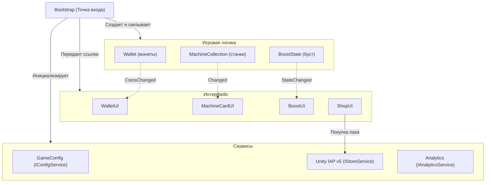

# Mini Factory

Мобильный кликер/тайкун на Unity 6 (6000.3.22f1) под Android (портретный режим 9:16). Проект разработан по тестовому заданию Unity Developer.

## Запуск и сборка

### В редакторе
1. Открыть проект в Unity Hub (`6000.3.22f1`).
2. Открыть сцену `Assets/_Project/Scenes/Main.unity`.
3. В окне **Game** выбрать разрешение **9:16 Portrait** (например, 1080x1920).
4. Запустить Play Mode.

### Сборка Android APK
1. Открыть **File > Build Settings**.
2. Выбрать платформу **Android** и нажать **Switch Platform**.
3. Убедиться, что сцена `Assets/_Project/Scenes/Main.unity` включена в список.
4. Нажать **Build** и указать путь для сохранения APK.

## Архитектура

- **Точка входа (Bootstrap):** единственный стартовый MonoBehaviour на сцене. Создает модели, инициализирует сервисы и передает ссылки компонентам интерфейса через `Initialize()`. В проекте нет `GameManager.Instance` и тяжелых DI-контейнеров.
- **Игровая логика:** классы `Wallet`, `MachineState` и `BoostState` не зависят от компонентов Unity и тестируются в EditMode без загрузки сцены.
- **Связь через события:** UI слушает C#-события моделей (`CoinsChanged`, `Changed`, `StateChanged`), а не опрашивает данные каждый кадр в `Update()`.
- **Изоляция SDK:** сервисы IAP, аналитики и конфига закрыты интерфейсами (`IStoreService`, `IAnalyticsService`, `IConfigService`), поэтому их можно подменять или дополнять (например, подключить Remote Config) без правок геймплея.
- **Офлайн и камера:** офлайн-доход рассчитывает калькулятор `OfflineProgressCalculator` (лимит до 2 часов, учет оставшегося буста), а `CameraResolutionFitter` держит кадрирование 9:16 на любых экранах.

## Стек и ассеты

- **Пакеты Unity:** `com.unity.purchasing` 5.4.4, `com.unity.render-pipelines.universal` 17.3.0 (URP 2D), `com.unity.ugui` 2.0.0, `com.unity.inputsystem` 1.20.0, `com.unity.test-framework` 1.6.0.
- **Графика и звук:** Kenney Tiny Factory (станки и пол), Kenney Pixel UI (плашки и кнопки), Kenney Audio (интерфейсные звуки).

## Unit-тесты

В проекте реализовано 10 EditMode тестов (`Assets/_Project/Scripts/Tests/GameplayTests.cs`):
- Валидация и списание баланса в `Wallet`.
- Разблокировка станков и масштабирование характеристик при улучшении.
- Корректность отсечки времени и применения буста в `OfflineProgressCalculator`.
- Таймер и события активации/завершения в `BoostState`.
- Рассылка событий нескольким провайдерам в `AnalyticsService`.
- Начисление валюты при подтверждении покупки в магазине.

Запуск тестов: **Window > General > Test Runner > EditMode > Run All**.

## Использование AI

- **Инструменты:** DeepSeek Harness + модель `gemini-3.8-flash-high` через `cliproxyapi`.
- **Контекст и правила агента:** системные инструкции адаптированы из [TrueUnityAgent](https://github.com/wssdozh/TrueUnityAgent) (каталог `.agents/` и файл `AGENTS.md`). Ключевые ограничения: Zero Junk, Composition Root вместо контейнеров, запрет скрытых синглтонов, Single State Owner, аккуратная работа с Unity YAML и `.meta`.
- **Что реализовано через AI:**
  - Каркас доменных моделей (`Wallet`, `MachineState`, `BoostState`, `OfflineProgressCalculator`).
  - Реализация `UnityIAPStoreService` под интерфейс `IStoreService` в режиме Fake Store.
  - Шина событий `AnalyticsService` под 8 обязательных событий ТЗ.
  - Скрипт адаптации камеры `CameraResolutionFitter` и базовый набор из 10 EditMode тестов.
- **Ручные правки и отклонённые предложения:**
  - Отклонена процедурная кодогенерация UI, кастомные пункты в меню Unity и отдельный скрипт сборки билда. Интерфейс собран в сцене стандартными средствами uGUI, сборка выполняется штатно через Build Settings.
  - Исправлена интеграция IAP: агент сгенерировал код под устаревший API Unity IAP v4 (`IStoreListener`), логика переписана под актуальный API v5.
  - Исправлен расчет покадрового дохода: агент использовал целочисленное округление `(int)(rate * Time.deltaTime)` каждый кадр, из-за чего при 60+ FPS доход ниже 60 монет/сек обнулялся. Добавлен дробный накопитель `_fractionalCoins`.
  - Устранена ошибка парсинга YAML после попытки агента вручную отредактировать fileID в файле сцены.
  - Заменены тайлы пола на бесшовные и исправлен текст кнопки буста из-за отсутствия спецсимвола молнии в SDF-шрифте.

Подробный отчет находится в [AI_USAGE.md](AI_USAGE.md).

## Профилирование и оптимизация (Бонус ТЗ)

Базовое профилирование Android-сборки (эмулятор Google Pixel 7, Portrait 1080x1920):

| Метрика | Значение | Описание |
|---|---|---|
| **Фреймрейт (FPS)** | 60 FPS | Стабильный фреймрейт без просадок |
| **CPU Main Thread** | 2.5 – 3.8 мс | Значительно ниже бюджета кадра (16.6 мс для 60 FPS) |
| **GC Allocations** | **0 B / кадр** | Нулевые аллокации в `Update()`: начисление через `_fractionalCoins`, процедурная анимация станков без аллокаций |
| **Draw Calls / Batches** | 12 – 16 батчей | Включен SRP Batcher в URP 2D, 9-slice спрайты, единый динамический TextMeshPro SDF атлас |
| **Аудио** | OGG Vorbis | Предзагрузка сжатых SFX, централизованный пул `FeedbackRoot` без спавна временных объектов |
| **Память (RAM)** | ~85 МБ | Основной объем занимает рантайм Unity и пайплайн URP 2D |

## Девайс тестирования и время

- **Устройство проверки:** эмулятор Google Pixel 7 (Android, 1080x1920 portrait).
- **Фактическое время выполнения:** ~4.5 часа.
